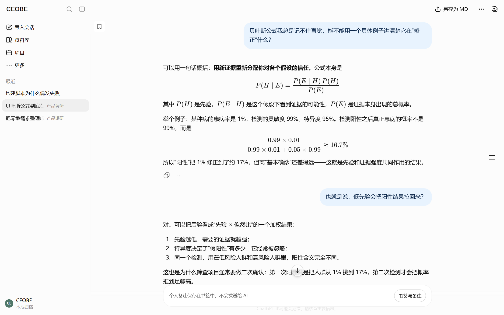
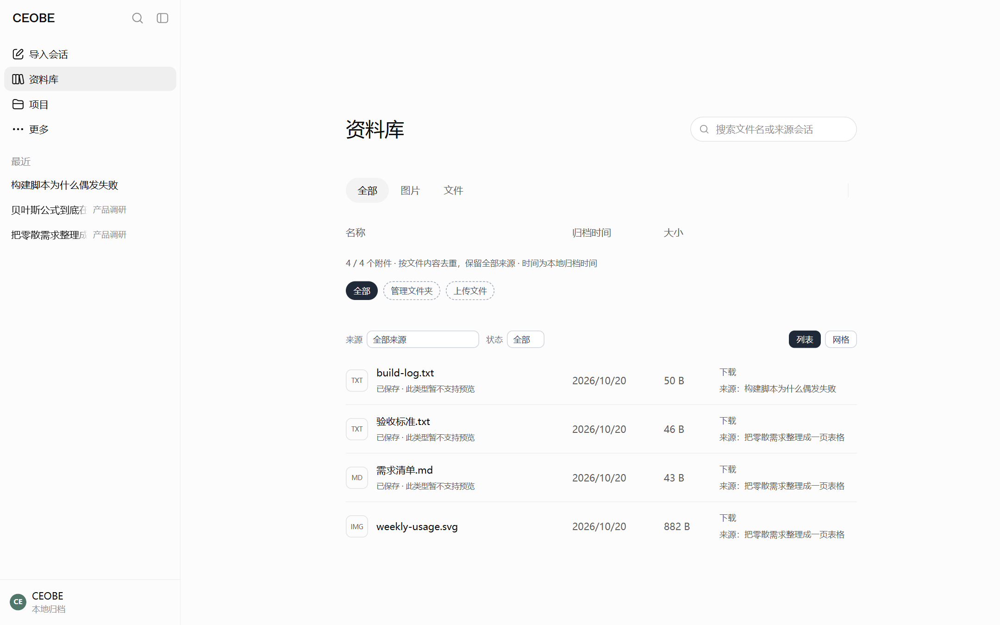
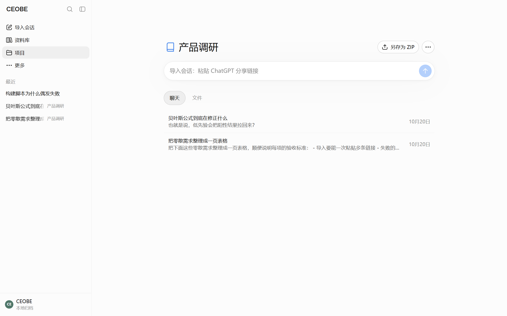
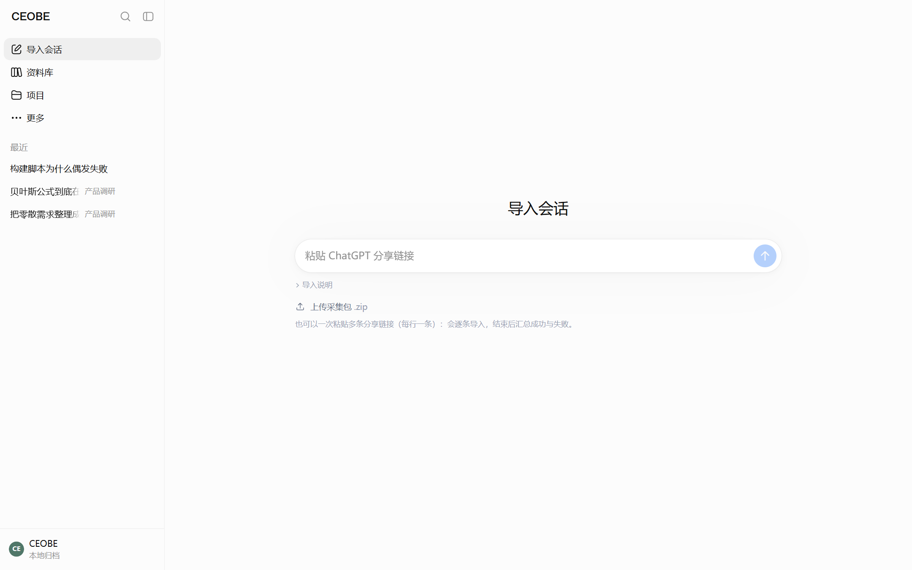

# CEOBE

**Chat Echoes: Offline Browsing Experience**

将 ChatGPT 对话保存到本地，以熟悉的界面重新阅读、整理和导出。

CEOBE 面向希望长期保留对话资料的人。它将分享链接中的聊天归档为本地文件，让你能重新查阅长对话、查看已保存的附件、按项目整理内容，并导出 Markdown。

它是一个**本地归档与阅读工具**，不是另一个 AI 聊天客户端。导入需要联网；已经保存且资源齐全的内容可以离线阅读。

## 为什么使用 CEOBE

有价值的对话往往不只是一段文字，还包含代码、公式、表格、图片和附件。CEOBE 希望在便于保存的同时，尽量保留这些内容的阅读体验，而不只是把聊天变成一份长文本。

- **保存下来**：通过分享链接归档，保留结构化内容、原始响应和资源状态，便于日后检查与迁移。
- **重新阅读**：使用基于 ChatGPT 网页界面的本地阅读器，浏览长对话、复制正文与代码、查看图片和受支持的附件。
- **整理成资料**：搜索聊天标题和正文（支持 `title:`、`from:`、`has:`、`-排除` 等语法）并直接跳到命中的消息、置顶常用对话，使用项目分组和本地项目简介组织内容。
- **留下重点与想法**：为消息添加书签、快速回到原文，并保存独立的个人备注；标题与备注不改写聊天。
- **带走文本**：将单条聊天另存为 Markdown、把一个项目内的聊天打包成 ZIP，或把整个档案导出为官方格式 JSON（可连附件）。

## 界面

| 阅读：公式、代码、表格按官方页面还原 | 资料库：附件、来源会话与文件夹 |
| --- | --- |
|  |  |

| 项目：按主题分组，一键另存为 ZIP | 导入：粘贴公开分享链接 |
| --- | --- |
|  |  |

> 截图来自仓库自带的**隔离演示夹具**（`scripts/make-readme-fixture.mjs` 生成的合成对话），不含任何真实聊天；
> 需要重新生成时运行 `node scripts/make-readme-fixture.mjs && node scripts/shoot-readme.mjs`。

## 快速开始

当前主要在 **Windows + Edge** 环境验证，建议使用 **Node.js 24.x** 和 **Python 3.11 或更新版本**。

下载或克隆本仓库，在项目根目录运行：

```powershell
npm install
python -m pip install pypdfium2 openpyxl
npm run library
npm run dev -- --host 127.0.0.1 --port 5173
```

Python 扩展用于 PDF 和 XLSX 预览。其他平台的浏览器准备、Python 路径及生产运行方式见[使用指南](docs/usage.md)。

打开 **http://127.0.0.1:5173/**，进入“导入会话”，粘贴你有权保存的 `https://chatgpt.com/share/…` 链接。也可以把浏览器扩展导出的 `ceobe-capture-*.zip` **直接拖到同一输入框**导入。导入完成后，即可从侧栏打开聊天，或将它归入项目。

首次启动不需要自己准备 JSON，也不需要先导入测试样本。已有归档时，`npm run library` 会重新生成档案库；没有归档时会生成空的应用页面。

## 数据与隐私

- **数据保存在本地工作区。** 聊天与附件位于 `archive/`，项目、书签备注和聊天显示元数据位于 `data/private/`。请为重要资料自行备份，详见[数据与备份](docs/usage.md#数据与备份)。
- **导入会访问分享页面和可获取的资源。** CEOBE 不要求登录个人 ChatGPT 账号；附件发现使用独立匿名浏览器，不读取个人浏览器配置。不要为了归档而公开不适合分享的内容。
- **保存范围取决于来源。** 分享页面没有提供的消息或资源无法凭空恢复；缺失情况会记录在归档报告中。
- **两种删除含义不同。** 删除项目只解除项目及关联，保留聊天、书签备注、附件和历史归档；删除聊天会永久删除该聊天的全部归档版本、书签备注及相应派生页面。
- **导出不等于备份。** MD 与项目 ZIP 是纯文本导出；官方格式 JSON 会带上已归档的附件，但仍不包含原始页面、`raw_payload` 与缺失资源，因此都不能代替完整归档备份。

## 当前限制

CEOBE 仍在持续完善，请先了解以下边界：

- 不提供 AI 续聊、AI 记忆或云端共享。阅读页保留的输入区不具备 AI 对话能力。
- 搜索覆盖聊天标题和阅读页可见的正文（提问、最终回复及其中的代码）；不搜索推理过程、引用来源、附件内容和书签备注。搜索框支持引号短语、`-排除`、`A/B`、`title:`、`from:`、`has:`、`created:` 与 `messages:` 语法，细节见[使用指南](docs/usage.md#搜索置顶与项目)。
- 图片和附件能否离线查看，取决于是否成功保存以及格式支持；PDF 以页面图片预览，XLSX 使用只读网格。
- 纯静态部署提供阅读快照；导入、修改项目、书签备注和即时 MD／ZIP 导出需要本地服务。
- 消息级操作只保留「复制」和「更多操作 / 编辑书签」：编辑消息、评价、云端分享、模型切换，以及生成图片的喜欢／不喜欢与图片悬浮层都不再出现在页面上。

后续方向见 [TODO](TODO.md)，具体使用边界见[使用指南](docs/usage.md)。

## 文档与开发

- [使用指南](docs/usage.md)：安装、导入、整理、导出、备份与故障排查。
- [架构说明](docs/architecture.md)：数据流、归档结构、渲染与离线资源。
- [开发指南](docs/development.md)：测试、模板维护与数据安全约定。
- [变更记录](CHANGELOG.md)：当前版本按功能域的能力、修复与已知限制。
- [后续计划](TODO.md)：尚未完成和待确认的工作。
- [同类项目与后续方向](docs/ecosystem.md)：GitHub 上的同类项目调研、可借鉴的设计与已批准的方向。
- [产品方向记录](docs/direction.md)：2026-10-28 关于时间线、记忆、数据契约与 AI 模块位置的讨论整理。

界面采用独立冻结的官方页面模板；正常构建不需要最初保存的参考网页。项目的结构化数据以 CEOBE JSON 为准，Markdown 与本地 HTML 是两个面向不同用途的输出。

## 许可与素材来源

- **代码**以 [MIT](LICENSE) 发布，可自由使用、修改与分发，请保留版权与许可声明。
- **不属于 MIT 许可的素材**：`official-templates/`、`official-assets/`、`official-assets/cdn/` 下是从**公开可访问**的 ChatGPT 页面与静态资源中提取的 HTML／CSS／SVG 快照，仅用于离线渲染同一份分享内容；其权利归原权利人，本仓库不主张任何权利，也不随代码许可授权。若你有其他授权渠道，请以该授权为准。
- **测试夹具已脱敏**：`fixtures/` 中的会话是把原始分享页改造成测试样本后提交的——本机绝对路径、Windows 用户名、真实附件（含一份含学生姓名与学号的表格）、真实分享链接与分享 id 都已替换或移除；PDF 与 XLSX 换成了同形状的合成内容。分享 id 也已旋转，无法从仓库拼回原链接。
- 本项目**与 OpenAI 没有隶属或背书关系**；"ChatGPT" 等名称仅用于说明兼容的来源页面。
